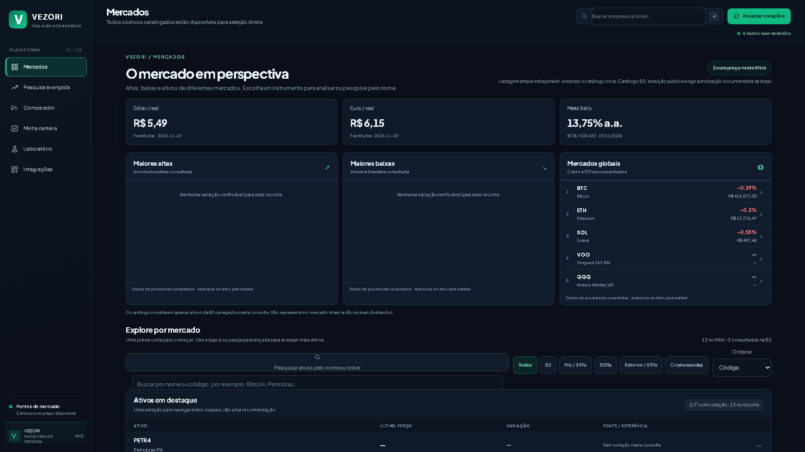

# VEZORI — inteligência de investimentos

Pesquisa de mercado, carteira local e simulações educacionais com fontes identificadas. JavaScript no navegador e Cloudflare Workers; Python separado para demonstrativos oficiais e reconciliação matemática.

[Aplicação](https://vezori.bruno-giacomelli1979.workers.dev) · [Repositório](https://github.com/brunogiacomelli1979-cyber/vezori) · [Auditoria](docs/AUDIT_4.md)

## Data Engine 1.0

Ingestão oficial DFP/ITR histórica por CNPJ, macro BCB/PTAX, informes de fundos/FIIs e taxas/PUs do Tesouro, sem novo redesign. Integrações permite consultar cobertura, revisões, indicadores conciliados e baixar registros com origem/licença. Preços EOD públicos continuam bloqueados onde faltam direitos; CSV privado legítimo pode alimentar análise local sem upload nem alterar as cotações da carteira. SEC permanece adiada por escolha do proprietário.

[Arquitetura, ciclos, métodos e testes](docs/DATA_ENGINE_1.md) · [Matriz de fontes e referências open source](docs/DATA_ENGINE_SOURCES_1.md). A disponibilidade efetiva e as datas estão em `/api/data-engine/status`; execução controlada não equivale a cron observado.

## Versão 4.0

A publicação desta versão deve ser confirmada em `/api/health`: `version:4.0.0` e `release` igual ao SHA do deploy. Um workflow verde ou um namespace criado, isoladamente, não comprovam histórico de preços operacional. O relatório de aceite em `docs/ACCEPTANCE_4.md` registra o resultado verificado.



[Laboratório em tela de 390 px — captura real de produção](docs/images/laboratorio-producao-mobile.png). Versão e horário das evidências em [Aceite](docs/ACCEPTANCE_4.md); [captura local anterior](docs/images/mercados-local.png) preservada para comparação.

| Área | Comportamento |
|---|---|
| Mercados e ficha | Catálogo local identificado e adaptadores brapi, CoinGecko e Twelve Data. Exibição B3/EUA condicionada a direitos documentados; ausência de fonte é explícita |
| Comparador | Séries base 100 apenas em datas comuns; moedas e bases identificadas. Não é retorno convertido nem total return |
| Fundamentos | CVM DFP/ITR histórica por CNPJ e versão; cinco tickers confirmados preservam fichas legadas. SEC preparada, dependente de identificação e ativação explícita |
| Carteira | Compras, vendas, taxas, proventos, custo médio, realizado/não realizado, XIRR, exportação JSON/CSV, importação v2/v3 e cópia recuperável |
| Laboratório | Cinco modelos didáticos; taxas hipotéticas editáveis, aportes, inflação, custos de gestão, imposto hipotético de liquidação e sensibilidade ±5 p.p. |
| Risco | Retorno de preço, volatilidade, drawdown, correlação; VaR/CVaR empíricos na ficha quando há 100 retornos. Motor adicional de CAGR, Calmar, Sortino e comparação a benchmark com pré-requisitos explícitos |
| Histórico | Snapshots diários e arquivos por ativo/mês, deduplicação e SHA-256. Retenção de cotações/FX exige autorização específica; cobertura integral permanece falsa |

## Dados, cobertura e direitos

Não existem preços fabricados, preenchimento de lacunas ou históricos anteriores à primeira coleta inventados. `max` significa máximo recebido da fonte/plano, não desde a listagem. Splits e dividendos não são reconciliados integralmente; métricas são de preço.

- **brapi:** os termos atuais restringem redistribuição e wrappers públicos. `BR_PUBLIC_DISPLAY_AUTHORIZED=true` só pode registrar autorização documental válida. Chave ou acesso sandbox não são autorização. Adaptadores permanecem disponíveis para testes e usos autorizados.
- **CoinGecko:** consulta de BTC/ETH/SOL com atribuição. Demo não comprova direito de formar arquivo permanente. Retenção exige `CRYPTO_ARCHIVE_AUTHORIZED` e acordo compatível.
- **Twelve Data:** chave e `US_PUBLIC_DISPLAY_AUTHORIZED` são condições separadas; retenção usa outra autorização.
- **BCB:** meta Selic SGS 432 com fonte, unidade e consulta limitada a datas passadas. Reprodução com atribuição conforme termos oficiais.
- **Frankfurter:** câmbio de referência diário; os termos das instituições de origem continuam aplicáveis.
- **CVM / SEC:** fatos oficiais, competência e revisão; não equivalem a múltiplos de valuation ou recomendação.

[Inventário completo das integrações e políticas](docs/DATA_GOVERNANCE_4.md).

## Arquitetura

```text
GitHub Actions → testes JS/Python/Playwright → assets locais + CVM → Wrangler
                                                                 ↓
Navegador ← /api/* + assets ← Worker → provedores com contratos explícitos
    ↓                             ↓
localStorage v2/v3             cron diário 02:30 UTC → KV
carteira + recuperação         apenas dados com retenção autorizada
```

`public/asset-registry.js` centraliza as 13 identidades locais, CIK/ID de fornecedor quando conhecidos e campos não verificados nulos; `/api/assets` não pretende representar toda a B3. O catálogo remoto é separado.

`finance.js` mantém o livro, `portfolio-storage.js` persiste antes de confirmar o estado, e módulos quantitativos ficam separados da UI. `history-contract.js` rejeita datas inválidas, futuras, conflitos e misturas de ajuste. O arquivo original nunca é substituído por uma série interpolada.

## Desenvolvimento

Node ≥22.20 (CI usa 24), Python ≥3.12.

```sh
npm ci
npm run build
npm run dev
```

O build copia as versões fixadas de Lightweight Charts 5.2.1 e Chart.js 4.4.8 para `public/vendor/`, incluindo licenças. Essa pasta é gerada e não é fonte autoral. O histórico de preço usa API v5; Chart.js permanece como fallback e para alocação/aportes.

```sh
npm run check
python -m unittest discover -s tests -p 'test_*.py'
npx playwright install chromium
npm run test:ui
npx wrangler deploy --dry-run
```

Fixtures sintéticas existem exclusivamente em `tests/`. Capturas de produção são feitas em contextos novos, sem acessar a carteira pessoal. Os testes de navegador usam 1920×1080, 1366×768, 768×1024 e 390×844, com axe para os módulos principais.

## Métodos

- Custo da compra em BRL = `(quantidade × preço + taxa) × câmbio histórico`. Venda baixa custo médio proporcional e reconhece receita líquida menos custo baixado.
- Marcação = quantidade × preço observado × câmbio de referência; cobertura incompleta impede total e XIRR apresentados como completos.
- XIRR usa dias efetivos/365,25 e raiz de valor presente; não é cálculo tributário nem a convenção Excel ACT/365.
- Volatilidade = desvio amostral de retornos simples × √252 (bolsa) ou √365 (cripto).
- Drawdown = maior queda de um pico anterior observado. VaR/CVaR são perdas empíricas diárias a 95%, não probabilidades futuras garantidas.
- Juros mensais efetivos no laboratório; aportes no fim do mês. Custos são deduzidos mensalmente; imposto hipotético apenas sobre ganho positivo por posição em cada valor de liquidação apresentado. Inflação desconta o montante final para poder de compra inicial. Não modela regras fiscais reais.

[Métodos e validação independente](docs/MATH_4.md). Faixas históricas continuam experimentais; o estudo temporal não elimina viés de sobrevivência nem demonstra lucro executável.

## Publicação e recuperação

O CI exige testes, build, credenciais válidas, binding real, escrita/leitura/releitura de uma chave diagnóstica e smoke com SHA publicado. Uma captura controlada separada utiliza exclusivamente a observação oficial BCB. Arquivo de cotações continua dependente das licenças.

[Operação, permissões e rollback](docs/OPERATIONS_4.md). Não crie recursos pagos ou namespaces duplicados. Não coloque tokens no Git, chat ou logs. Configurar uma autorização de dados sem documento não cria uma licença.

## Segurança e privacidade

A carteira permanece no dispositivo; não há login, sincronização ou conexão com corretoras. Corrupção bloqueia novas gravações até restauração explícita; bytes originais ficam exportáveis. Faça backups: armazenamento do navegador não substitui backup externo.

CSP, cabeçalhos de segurança e scripts gráficos locais reduzem a superfície de terceiros. Cache e limites de paginação não constituem rate limiting global; o risco de abuso de cotas permanece documentado. SHA-256 detecta corrupção, não autentica a fonte nem torna KV transacional.

## Skills e open source

As skills foram instaladas exclusivamente no checkout, com `skills@1.7.6`, e verificadas por `skills list -a codex`. Consulte [revisões, aplicação e matriz de viabilidade](docs/ENGINEERING_4.md). Nenhuma biblioteca Python pesada executa no Worker. Não foi incorporado código Ghostfolio/AGPL ou VectorBT/Commons Clause.

O código autoral permanece [MIT](LICENSE); dependências preservam suas próprias licenças e créditos TradingView. Direitos sobre dados são independentes da licença do código.

## Pendências

Retenção e redistribuição licenciadas por mercado; calendários oficiais, corporate actions, câmbio histórico e retorno total; histórico patrimonial ponto no tempo; ISIN/listagem verificadas para o universo amplo. Monte Carlo e otimização não foram promovidos sem dados e validação apropriados. Nenhum serviço pago foi contratado.

O [README anterior](docs/README_3_ARCHIVE.md) permanece arquivado como registro histórico. VEZORI é educacional: não executa ordens, não oferece recomendação personalizada e não garante retornos.
